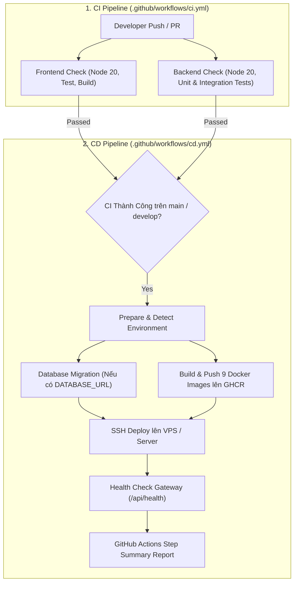

# 🚀 Hướng Dẫn CI/CD Pipeline - WINGS Social Network

Tài liệu này cung cấp hướng dẫn chi tiết về hệ thống Tích hợp liên tục (CI) và Triển khai liên tục (CD) tự động cho dự án **WINGS Social Network**.

---

## 📌 1. Tổng quan Kiến trúc CI/CD



---

## ⚙️ 2. Các File Cấu Hình Chính

| Đường dẫn | Vai trò |
| :--- | :--- |
| `.github/workflows/ci.yml` | Pipeline kiểm thử tự động (Unit Test, Integration Test, Lint, Vite Build). |
| `.github/workflows/cd.yml` | Pipeline triển khai tự động (Build Docker Images, GHCR Registry, SSH Server Deploy, Healthcheck). |
| `scripts/deploy.sh` | Shell script triển khai độc lập trên máy chủ hoặc local hỗ trợ cả Monolith và Microservices. |
| `docker-compose.yml` | Cấu hình Docker Compose môi trường Monolith / Hybrid. |
| `docker-compose.microservices.yml` | Cấu hình Docker Compose môi trường Full Microservices. |

---

## 🎯 3. Cơ chế Kích hoạt CD Pipeline (`cd.yml`)

1. **Tự động theo chuỗi CI (`workflow_run`)**:
   - Khi pipeline `WINGS Social CI Pipeline` hoàn tất thành công trên các nhánh `main`, `master` hoặc `develop`, CD Pipeline sẽ tự động được kích hoạt.
   - Nhánh `main` / `master` $\rightarrow$ Triển khai môi trường **Production**.
   - Nhánh `develop` $\rightarrow$ Triển khai môi trường **Staging**.

2. **Kích hoạt theo Release Tag (`push: tags`)**:
   - Khi tạo tag phát hành mới (ví dụ: `v1.0.0`, `v2.0.0`), pipeline tự động đóng gói image với tag tương ứng và deploy Production.

3. **Kích hoạt thủ công (`workflow_dispatch`)**:
   - Vào tab **Actions** $\rightarrow$ chọn **WINGS Social CD Pipeline** $\rightarrow$ nhấn **Run workflow**.
   - Các tham số tùy chọn:
     - `environment`: `production` hoặc `staging`.
     - `deploy_strategy`: `docker-compose-monolith`, `docker-compose-microservices`, hoặc `build-only`.
     - `run_migrations`: `true` hoặc `false`.

---

## 🔑 4. Thiết lập GitHub Secrets & Variables

Để kích hoạt đầy đủ tính năng triển khai tự động lên máy chủ và cơ sở dữ liệu, hãy thêm các biến sau vào **Repository Settings > Secrets and variables > Actions**:

### 🔒 Repository Secrets (Bảo mật):
- `DATABASE_URL`: Chuỗi kết nối PostgreSQL / Supabase dùng để tự động chạy migration trước khi khởi động dịch vụ mới.
- `SERVER_HOST`: Địa chỉ IP hoặc Domain máy chủ VPS/Cloud.
- `SERVER_USER`: Tên tài khoản SSH trên máy chủ (ví dụ: `ubuntu`, `debian`, `root`).
- `SERVER_SSH_KEY`: Khóa SSH Private Key dùng để xác thực không cần mật khẩu.
- `SERVER_PORT`: Cổng SSH (mặc định: `22`).
- `SERVER_DEPLOY_PATH`: Đường dẫn thư mục mã nguồn trên máy chủ (mặc định: `/var/www/wings-social`).

> [!NOTE]
> Nếu chưa cấu hình các SSH Secrets, CD Pipeline vẫn sẽ **tự động Build và Push tất cả Docker Images lên GitHub Container Registry (GHCR)** thành công mà không báo lỗi.

---

## 🐳 5. GitHub Container Registry (GHCR)

Tất cả Docker Images được đóng gói và lưu trữ tập trung tại `ghcr.io` với cache nhiều tầng:
- `ghcr.io/<owner>/wings-gateway`
- `ghcr.io/<owner>/wings-frontend`
- `ghcr.io/<owner>/wings-express-backend`
- `ghcr.io/<owner>/wings-fastapi-backend`
- `ghcr.io/<owner>/wings-ai-service`
- `ghcr.io/<owner>/wings-user-service`
- `ghcr.io/<owner>/wings-post-service`
- `ghcr.io/<owner>/wings-moderation-service`
- `ghcr.io/<owner>/wings-notification-service`

Mỗi image được gắn tag theo:
- Commit SHA ngắn (ví dụ: `:a1b2c3d`)
- Tên môi trường (ví dụ: `:production`, `:staging`)
- Tag `:latest` (dành riêng cho nhánh Production)

---

## 💻 6. Triển khai Thủ công qua `scripts/deploy.sh`

Trên máy chủ hoặc môi trường phát triển, bạn có thể thực thi trực tiếp script triển khai:

```bash
# Cấp quyền thực thi
chmod +x scripts/deploy.sh

# Triển khai mô hình Monolith (mặc định)
./scripts/deploy.sh

# Triển khai mô hình Microservices
./scripts/deploy.sh --mode microservices

# Triển khai bỏ qua Database Migration
./scripts/deploy.sh --skip-migration
```
