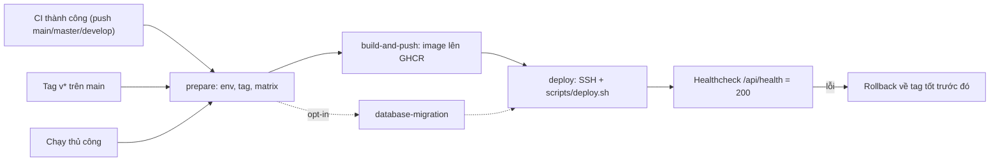

# 🚀 Hướng dẫn CD Pipeline - WINGS

CD nằm ở [`.github/workflows/cd.yml`](../../.github/workflows/cd.yml), chạy sau CI ([`ci.yml`](../../.github/workflows/ci.yml)).



## 1. Kích hoạt

| Sự kiện | Môi trường | Ghi chú |
| :-- | :-- | :-- |
| CI xanh trên `main` / `master` | `production` | Chỉ nhận CI chạy bởi `push`, không nhận PR |
| CI xanh trên `develop` | `staging` | |
| Push tag `v*` | `production` | Tag **phải nằm trên `main`**, nếu không job fail |
| Chạy thủ công | chọn | Chọn môi trường, kiến trúc, migration |

CD luôn checkout **đúng commit đã qua CI** (`workflow_run.head_sha`).

> [!IMPORTANT]
> `workflow_run` chỉ kích hoạt khi `cd.yml` đã có trên nhánh mặc định (`main`). Cần merge file này vào `main` trước thì CD tự động mới chạy.

## 2. Kiến trúc triển khai

Repo variable `DEPLOY_STRATEGY` (hoặc input khi chạy tay), mặc định `monolith`:

| Giá trị | Compose | Image được build |
| :-- | :-- | :-- |
| `monolith` | `docker-compose.yml` + `docker-compose.prod.yml` | gateway, frontend, express, fastapi, ai-service |
| `microservices` | `docker-compose.microservices.yml` + `docker-compose.microservices.prod.yml` | gateway, frontend, fastapi, ai-service, user/post/moderation/notification-service |
| `build-only` | (không deploy) | tất cả 9 image |

Hai file `*.prod.yml` chỉ thêm `image:` trỏ về GHCR (`ghcr.io/<owner>/wings-<tên>:<tag>`) nên máy chủ **không build lại**, chạy đúng image CI đã dựng.

> [!NOTE]
> `microservices` dùng PostgreSQL chạy trong compose (`wings_dev`), còn `monolith` dùng `DATABASE_URL` (Supabase) trong `backend/.env`.

## 3. Cấu hình GitHub

Tạo 2 **Environments**: `staging` và `production` (Settings → Environments). Nên bật *Required reviewers* cho `production`.

**Secrets (đặt theo từng environment, để staging không ghi đè production):**

| Secret | Ý nghĩa |
| :-- | :-- |
| `SERVER_HOST`, `SERVER_USER`, `SERVER_SSH_KEY` | Truy cập SSH (thiếu → chỉ build/push, bỏ qua deploy) |
| `SERVER_PORT` | Mặc định 22 |
| `SERVER_DEPLOY_PATH` | Mặc định `/opt/wings` |
| `DATABASE_URL` | Chỉ cần khi chạy migration thủ công |

**Variables (tùy chọn):** `DEPLOY_STRATEGY`, `HEALTH_URL` (mặc định `http://127.0.0.1:5000/api/health`), `AI_MODELS_ROOT` (mặc định `/opt/wings/models`), `PUBLIC_API_URL`.

`PUBLIC_API_URL` để **trống** là đúng: frontend gọi cùng origin, nginx proxy `/api/` sang `api-gateway`. Chỉ đặt khi API ở domain khác (giá trị được build cứng vào bundle).

## 4. Chuẩn bị máy chủ (một lần)

```text
<SERVER_DEPLOY_PATH>/
├── backend/.env              # BẮT BUỘC, tạo tay từ backend/.env.example (secret thật)
└── (CD tự upload compose + scripts/deploy.sh)
<AI_MODELS_ROOT>/             # mặc định /opt/wings/models
├── image_moderation/         # config.json + efficientnet_b1_best.pt
└── text_moderation/          # PhoBERT: config, tokenizer, weights
```

- Cài Docker + Docker Compose v2, mở cổng 80 (và 5000 nếu cần).
- Trọng số model (`*.pt`, `*.bin`, `*.safetensors`) bị `.gitignore` nên **không có trong image**, phải copy sẵn lên máy chủ. `deploy.sh` sẽ báo lỗi rõ ràng nếu thiếu.
- `deploy.sh` không tự tạo `backend/.env` từ file mẫu để tránh chạy production bằng giá trị giả.

## 5. Healthcheck và rollback

`scripts/deploy.sh` chờ tối đa ~3 phút cho `GET /api/health` trả **200** (mọi service UP; 207 nghĩa là còn service lỗi). Nếu thất bại: in log, tự động chạy lại **tag tốt gần nhất** (lưu ở `.deploy-state/`), rồi job báo đỏ.

## 6. Database migration

Mặc định **không tự chạy**. `npm run migrate` chạy `schema.sql` + `seed.sql` + `migrations/*.sql` mỗi lần, **không phù hợp với DB đang có dữ liệu**. Chỉ bật `run_migrations` khi chạy tay cho DB mới. Với DB hiện có, áp dụng migration thủ công như README mô tả.

## 7. Chạy tay trên máy chủ

```bash
# Dùng image từ GHCR
./scripts/deploy.sh --mode monolith --registry ghcr.io/<owner> --tag <tag>
# Build trực tiếp từ mã nguồn (dev / lần đầu)
./scripts/deploy.sh --mode microservices --build-local
```

> [!TIP]
> Nếu package GHCR chưa liên kết với repo hoặc máy chủ không pull được, đăng nhập sẵn bằng PAT có `read:packages` (`docker login ghcr.io`) rồi chạy lại.
